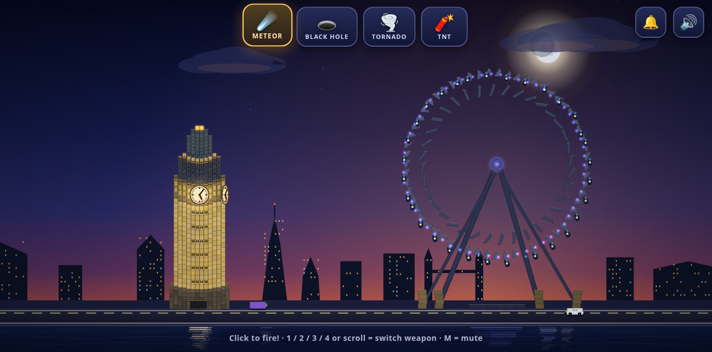
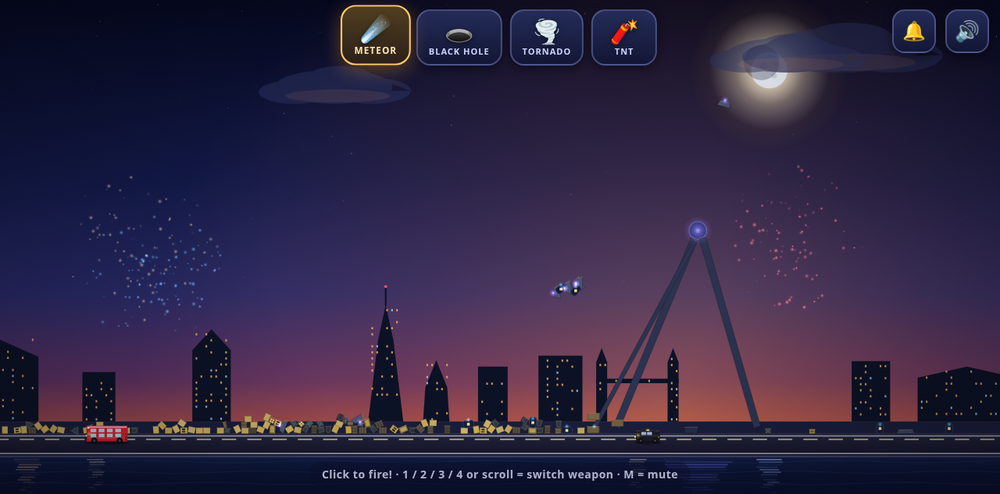

# LONDON BOOM! 💥

A browser physics-destruction game for kids (built for a 6-year-old London-wrecker).
Elizabeth Tower (Big Ben), the London Eye and London traffic stand by the Thames at
dusk — smash them with meteors, black holes, tornadoes and TNT until the fireworks
celebrate you. Then KEEP PLAYING in the ruins.

**▶ Play it live:** https://london-boom.vercel.app





- **Zero build step** — plain HTML + JS + vendored Matter.js. No bundler, no npm.
- **Zero runtime network** — everything (physics, rendering, sound, bells) is local
  and synthesized. Works from `file://` and as static hosting; installable as a PWA
  that runs **offline**.

## Run it

**Option 1 — just open it**

Double-click `index.html` (any modern browser: Chrome, Edge, Firefox, Safari).

**Option 2 — serve it** (needed once for PWA install)

```bash
cd london-boom
python3 -m http.server 8080
# open http://localhost:8080
```

**Install on an Android phone/tablet (Chrome)**

1. Serve the game (or open the deployed URL) in Chrome.
2. Tap the ⋮ menu → **Add to Home screen** / **Install app**.
3. Launch LONDON BOOM! from the home screen — full screen, no browser bars.
4. After the first load it works **offline** (service worker caches the game).

## Play

| Action | How |
| --- | --- |
| Fire selected weapon | click / tap anywhere on the scene |
| Switch weapon | keys `1` `2` `3` `4`, mouse wheel, or the four big emoji buttons |
| Ring Big Ben | 🔔 button (top right) — full 12 o'clock: Westminster Quarters + 12 strikes |
| Mute | 🔊 button (top right) or key `M` |
| After the win | 🎆 **KEEP PLAYING** (stay in the broken world, fireworks keep going) or 🔁 **PLAY AGAIN** (full reset) |

- ☄️ **METEOR** — a dense fireball streaks in from the top of the screen toward your
  click and detonates: radial blast, white flash, shockwave ring, screen shake,
  embers, smoke, vaporized masonry.
- 🕳️ **BLACK HOLE** — a singularity spawns for ~3.5 s, pulls everything in a wide
  radius inward (1/r², clamped) with a spiralling swirl, swallows bodies and even
  the Eye's cables that cross its core, then releases with a small blast. The feed
  counter (`×N`) grows as it eats.
- 🌪️ **TORNADO** — a wandering vortex spins for ~5 s: tangential suction + upward
  lift that widens with height, shreds the wheel's light constraints, flings bodies
  in arcs; they rain down (and bob in the Thames).
- 🧨 **TNT** — click to place a Minecraft-style TNT block right where you aimed:
  a real physics body that falls, stacks, and can be knocked around by your other
  weapons before it goes off. Each block runs its own 3.0-second fuse (white flash
  accelerating toward detonation, hissing fuse) and then explodes — radial blast,
  fire, embers, smoke, shockwave ring, white flash, screen shake, synthesized boom.

### v2 — the Elizabeth Tower upgrade

- **The tower, for real** — rebuilt from ~290 to **462 blocks** across 17 masonry
  courses modelled on the actual Elizabeth Tower (96 m on a 12 m footprint,
  researched from parliament.uk + Wikipedia + photo analysis): rusticated plinth →
  golden Anston-limestone shaft with paired lancet windows → ornate string course →
  clock stage with glowing dials (front + side, ≈half the tower width) → belfry with
  big dark louvred pointed arches → the glowing Ayrton Light lantern → tiered
  openwork iron crown → gilded finial.
- **Road + London traffic** — a two-lane embankment road across the whole screen
  with lane markings. Up to 3 vehicles at once: red double-decker buses, black TX
  cabs and cars in assorted colours, driving both directions. Hit one with a meteor
  or TNT → it explodes on the spot; a tornado or black hole flings it through the
  air (engine dead) and it blows up when it lands. Blast damage also chips the
  landmarks.
- **KEEP PLAYING** — after the win fireworks, jump straight back into the ruins:
  remaining blocks, running traffic, and periodic celebratory fireworks while you
  play on. PLAY AGAIN still gives the full exact reset.
- **The clock tells real time** — big glowing dials animated with your actual local
  time (hour/minute/smooth seconds). Both visible faces agree, like the real four.
- **Big Ben's bells** — synthesized bell strikes (inharmonic partials, long decay).
  Destroy the clock stage / belfry and you hear the **cracked bell**: off-pitch
  partials + a crack noise burst (the real Great Bell cracked in 1859 and was
  rotated, with a lighter hammer and a square cut out of the rim — it has sung
  slightly sharp ever since). The 🔔 button plays the complete 12 o'clock sequence:
  Westminster Quarters changes 2-3-4-5 (G♯4/F♯4/E4/B3) then 12 strikes on E3.
  Mute silences everything.
- **Installable PWA** — manifest + service worker + icons; installable on Android
  Chrome, runs offline, works in portrait and landscape.

Destroy both landmarks (integrity below 45%) → fireworks finale + 🎉 YOU DID IT!

## Project layout

```
index.html            minimal shell: canvas, HUD, title/win overlays (all CSS inline)
game.js               the whole game (custom Canvas2D renderer, fixed-timestep loop)
sw.js                 service worker: cache-first local shell (offline + installable)
manifest.json         PWA manifest (name, icons, standalone display, dusk colors)
icons/                generated PNG icons (192/512 + maskable variants)
vendor/matter.min.js  Matter.js 0.20.0 (MIT, vendored — the only library)
tools/gen_icons.py    regenerates the icons (Pillow, build-time only)
tools/tower_stability_test.js  Node harness: simulates the tower, asserts no self-collapse
```

Engineering notes: fixed-timestep physics (60 Hz accumulator, max 4 steps/frame),
body sleeping, pooled particles (cap 3400), devicePixelRatio-aware canvas (capped
at 2), NaN/velocity/out-of-bounds guards every step, full window-resize support,
all audio synthesized with WebAudio (no files), touch/pointer events throughout,
service worker caches local files only (skipped silently on `file://`).

The world runs at 0.6 g — the sweet spot where the 462-block tower and the
157-part Eye stay put until you hurt them, but debris still falls naturally.
All tower courses stack on one shared 12-column grid (centred subsets only) —
verified stable over 90 s of simulated physics (`tools/tower_stability_test.js`).
The Eye idle-rotates gently (wheel-speed-gated motor) with LED rim glow until
damaged; the glowing clock faces keep real time wherever the clock blocks drift.

## Test hook (harmless, for automated verification)

```js
__TEST__.bodyCounts()        // { tower, eye, dynamic, static, total, towerKinds }
__TEST__.landmarkIntegrity() // { tower, eye, towerTop } 0..1 (1 = intact)
__TEST__.vehicles()          // { counts: { onScreen, exploded, flung }, list: [...] }
__TEST__.clock()             // { h, m, s, ms } — real local time shown on the dials
__TEST__.bell()              // { scheduled, played, strikes, active, brokenPlayed, brokenEvents }
__TEST__.playTwelve()        // fires the full 12:00 sequence programmatically
__TEST__.keepPlaying()       // same as the KEEP PLAYING button
__TEST__.weaponFired         // { meteor, blackhole, tornado, tnt } live counters
__TEST__.events              // { explosions, consumed, fireworks, vehiclesExploded, vehiclesFlung, brokenBell, ... }
__TEST__.tnt()               // live TNT blocks: [{ id, x, y, fuse (s remaining), blink }]
__TEST__.fire(weapon, x, y)  // programmatic fire in world coords (1600x900)
__TEST__.screenToWorld(cx, cy)
__TEST__.destroyAll()        // test shortcut: wreck both landmarks
__TEST__.reset()             // full world reset (same as PLAY AGAIN)
__TEST__.state()             // { phase, fps, particles, vehiclesOnScreen, continueMode, ... }
__TEST__.step(n)             // headless helper: pump n exact fixed physics steps
__TEST__.renderFrame()       // headless helper: paint one frame on demand
__TEST__.errors              // collected console/page errors (should stay [])
```

World design space is a fixed 1600×900; the renderer letterboxes/scales to any
window. Fire weapons via real pointer events on the canvas for the full path
(the game converts client → world coordinates itself).

## Deploy (Vercel)

It's a static site — no config needed:

```bash
vercel deploy --prod   # from this directory
```

(or import the directory/repo in the Vercel dashboard; framework preset:
"Other", no build command, output directory: `.`)

When redeploying: bump the `CACHE` name in `sw.js` whenever a cached shell file
changed — that cache-name change is what makes clients pick up the new build.

## Credits

- Physics: [Matter.js](https://brm.io/matter-js/) 0.20.0 by @liabru (MIT) — vendored in `vendor/`.
- Everything else: hand-rolled Canvas2D + WebAudio, made with 💥 for a small destroyer of cities.

## License

MIT — see [LICENSE](LICENSE). © 2026 Martin Mogis.
