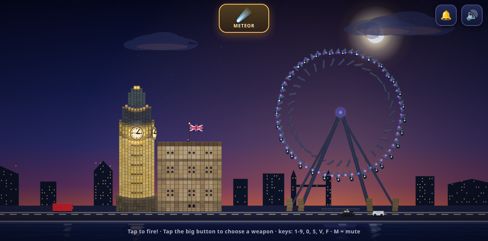
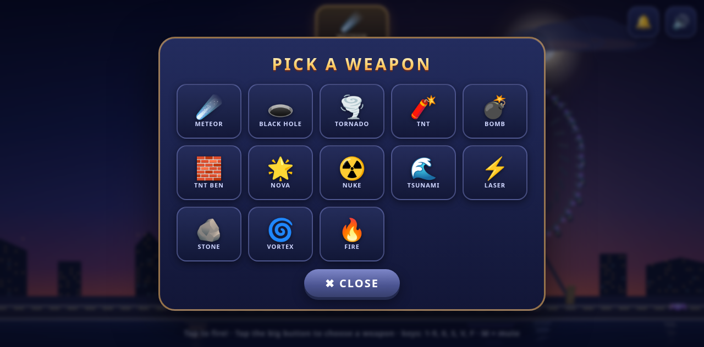

# LONDON BOOM! 💥

A physics-destruction game for kids — built for a 6-year-old London-wrecker.
Elizabeth Tower (Big Ben), its Westminster palace wing, the London Eye and
London traffic stand by the Thames at dusk. You have **13 weapons**.
Break everything. Fireworks celebrate you. 🇬🇧

**▶ Play it live:** https://london-boom.vercel.app

## The arsenal

| Weapon | What it does |
| --- | --- |
| ☄️ METEOR | fireball streaks in and detonates — blast, flash, shockwave |
| 🕳️ BLACK HOLE | swallows everything nearby for ~3.5 s, then pops |
| 🌪️ TORNADO | wanders for ~5 s, lifts and flings masonry and buses |
| 🧨 TNT | place it anywhere — real physics block, 3 s flashing fuse |
| 💣 BOMB | classic round bomb, 2 s fuse, solid punch |
| 🧱 TNT BEN | a 3-stack of TNT with a **3× blast** — the big one |
| 🌟 NOVA | 3 s charge-up, then a supernova: huge colourful multi-ring blast |
| ☢️ NUKE | siren… then a vaporization wave eats EVERY structure on screen + an animated mushroom cloud |
| 🌊 TSUNAMI | a wave rolls in from the Thames and sweeps the city |
| ⚡ LASER | horizontal beam from a screen edge, cuts blocks in its path |
| 🪨 STONE | a giant boulder rolls through traffic and walls |
| 🌀 VORTEX | a 5 s whirlpool that drags debris in and grinds it up |
| 🔥 FIRE | a fire wave spreads along the ground in both directions |

Tap the big weapon button (top middle) to open the picker — the game pauses
while you choose. No reading needed: big emoji, big buttons, instant action.

## The city

- **Elizabeth Tower** — 462 blocks across 17 researched masonry courses:
  plinth → limestone shaft → clock stage with glowing dials → belfry →
  lantern → iron crown → gilded tip. The clock shows **your real time**;
  the 🔔 button rings the full 12 o'clock Westminster chimes (destroy the
  belfry and you'll hear the cracked bell).
- **The palace wing** — a 271-block Westminster annex attached to the
  tower, Union Jack waving on its roof. Knock out the tower's wall and the
  wing comes down with it — or bring down the wing and crack the tower.
- **The London Eye** — 157 physics parts, quietly turning, hanging pods.
- **Traffic** — red double-deckers, black cabs and cars. Blast them, fling
  them, sweep them away, roll over them.
- **Win** (wreck tower + Eye) → fireworks + fanfare, then the game keeps
  going in the ruins **by itself** (traffic + fireworks continue — no win
  screen, no pause). 🔄 **NEW GAME** (top left, there from the start) or `N`
  restarts fresh at any moment.

## Controls

| Action | How |
| --- | --- |
| Fire | click / tap anywhere |
| Choose weapon | the big top button, keys `1`–`9` `0` `S` `V` `F`, or mouse wheel |
| Ring the bells | 🔔 (top right) |
| Mute | 🔊 (top right) or `M` |
| New game | 🔄 button (top left) or `N` — works any time after pressing PLAY |

## Run it

Double-click `index.html` — that's it (any modern browser, works from
`file://`). To install it as an offline app on Android: open the live URL
in Chrome → ⋮ → **Install app**; after the first load it runs offline.

## Under the hood

- **Zero build step** — plain HTML + JS + vendored [Matter.js](https://brm.io/matter-js/) 0.20.0. No bundler, no npm.
- **Zero runtime network** — physics, rendering, every sound (including the
  bells) synthesized with WebAudio. Nothing is fetched, ever.
- **Offline PWA** — service worker + manifest; caches local files only.
- Dev notes, test hooks and deploy instructions live in [docs/DEV.md](docs/DEV.md).

## Credits & license

Physics: Matter.js by @liabru (MIT), vendored. Everything else hand-rolled
Canvas2D + WebAudio, made with 💥 for a small destroyer of cities.

MIT — see [LICENSE](LICENSE).
